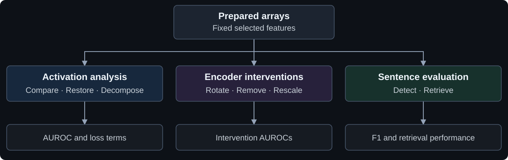

# SAE–Transcoder Comparison

Analysis code for *Sparse Autoencoders vs. Transcoders: Encoder Direction Use and Single-Feature Discrimination*.

We compare single-feature discrimination before and after JumpReLU, test encoder-direction interventions, and evaluate entity detection and sentence retrieval.

[Usage & input formats](docs/usage.md) · [Validation & provenance](docs/validation.md)

> **Scope:** These seven CPU analyses use prepared arrays. This is not an end-to-end pipeline from raw text: checkpoints, activation capture, cluster construction, and data are not included.

## Analysis overview



## Analyses

| Question | Scripts |
| --- | --- |
| How does discrimination change through JumpReLU? | [Compare](compare_activations.py) · [Restore](restore_activations.py) · [Decompose](decompose_loss.py) |
| How do encoder directions contribute to discrimination? | [Rotate](rotate_encoder.py) · [Edit components](edit_components.py) |
| How useful are individual features on labeled sentences? | [Detect entities](detect_entities.py) · [Retrieve sentences](retrieve_sentences.py) |

## Quick start

Python **3.10+** · NumPy · SciPy · CPU

```sh
git clone https://github.com/jinsu-kim/sae-transcoder-comparison.git
cd sae-transcoder-comparison
python -m pip install -r requirements.txt

# Run synthetic tests; no model or dataset download needed.
python -m unittest discover -s tests -v
```

With a prepared replay file (not included):

```sh
python compare_activations.py data/replay.npz --coder sae --output results/sae_auc.csv
```

See [input formats and all seven commands](docs/usage.md) before preparing data.
Each script also supports `--help`.

## Reproducibility

Numerical functions were extracted from the original experiments; [source hashes and function mappings](source_map.json) record their provenance.
Tests cover synthetic inputs and optional comparisons against the original sources.
**Full-data paper-result replay has not been run for this cleaned release.**
See [validation details and limitations](docs/validation.md).
